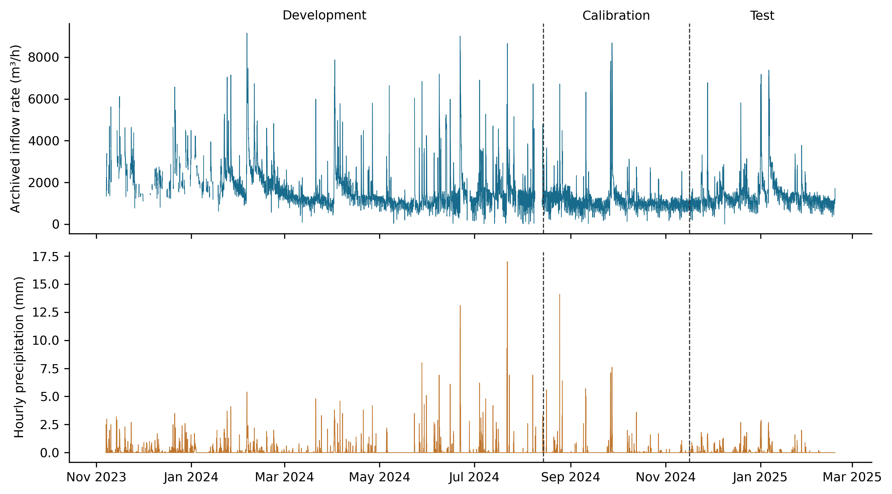
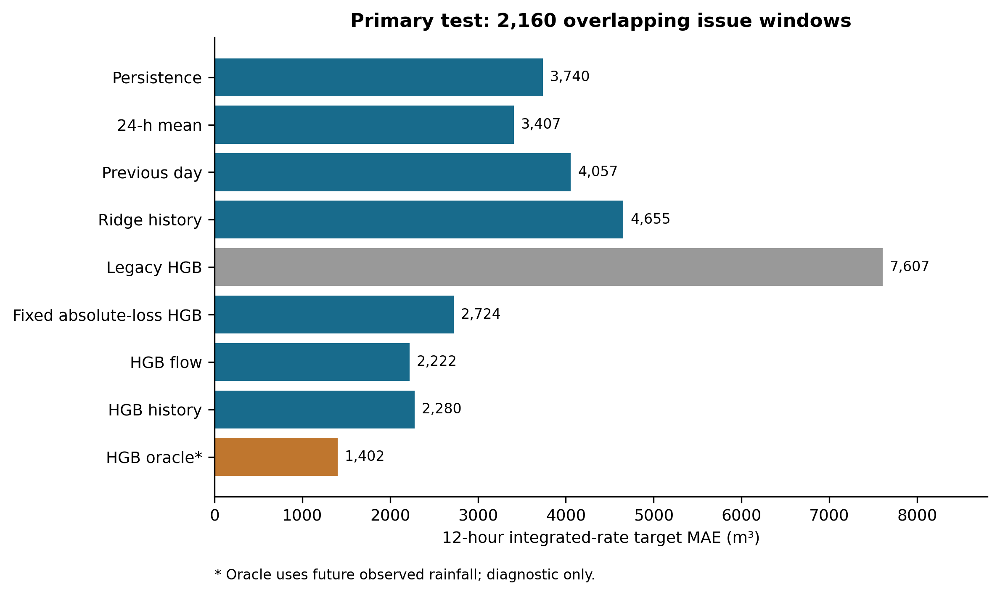
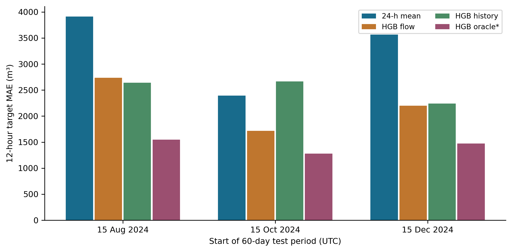
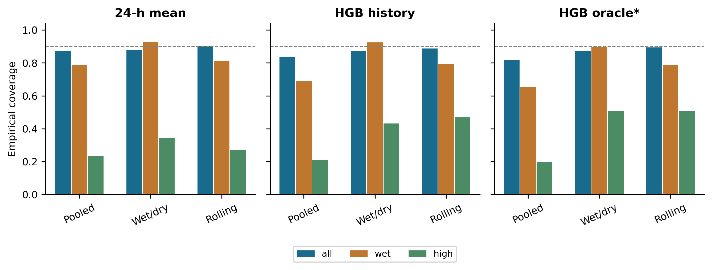
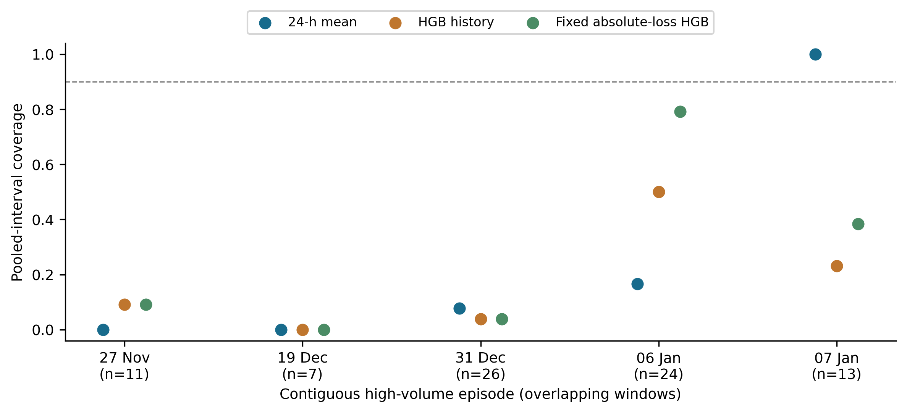

# Manuscript section and paragraph audit

Every substantive paragraph, caption and reference is indexed below. This register records inspection scope, not proof of every interpretation. Numeric tables are separately checked in full by audit_project.py.

| Item | Section | Opening text | Evidence / limit |
| --- | --- | --- | --- |
| 1 | Configuration sensitivity and conditional reliability in wastewater inflow volume forecasting: a two-site open-data audit | **Viet Nam Tran** | Authorship/availability and consistency review; no inferred email or approval |
| 2 | Configuration sensitivity and conditional reliability in wastewater inflow volume forecasting: a two-site open-data audit | Faculty of Environment, Van Lang University, Ho Chi Minh City, Vietnam | Authorship/availability and consistency review; no inferred email or approval |
| 3 | Highlights | - Loss and annual predictors reversed the ranking of an open inflow benchmark. | Authorship/availability and consistency review; no inferred email or approval |
| 4 | Highlights | - A German-site evaluation added 6,588 test windows and 41 high-volume episodes. | Authorship/availability and consistency review; no inferred email or approval |
| 5 | Highlights | - Historical rainfall gains and rolling calibration behavior differed by site. | Authorship/availability and consistency review; no inferred email or approval |
| 6 | Highlights | - Aggregate coverage concealed substantially poorer high-volume reliability. | Authorship/availability and consistency review; no inferred email or approval |
| 7 | Highlights | - Versioned data, predictions and executable checks support open reproduction. | Authorship/availability and consistency review; no inferred email or approval |
| 8 | Abstract | Wastewater inflow forecasting requires accurate hydraulic-load estimates and reliable uncertainty statements.  | results/ and external_results/; audit_project.py; verification/ |
| 9 | Keywords | Wastewater inflow; cumulative volume; temporal validation; prediction intervals; model sensitivity; open scien | Authorship/availability and consistency review; no inferred email or approval |
| 10 | 1. Introduction | Machine learning is increasingly used for monitoring and prediction in wastewater treatment [1]. Inflow foreca | sources/verified_crossref.json; paper/references.bib; publisher/provider records |
| 11 | 1. Introduction | Probabilistic inflow prediction and meteorological predictors are established research directions. Sonnenschei | sources/verified_crossref.json; paper/references.bib; publisher/provider records |
| 12 | 1. Introduction | A narrower question remains useful for a public benchmark: how robust is the scientific interpretation of a fo | sources/verified_crossref.json; paper/references.bib; publisher/provider records |
| 13 | 1. Introduction | We therefore investigate three research questions. RQ1 asks how loss and annual predictors affect relative per | sources/verified_crossref.json; paper/references.bib; publisher/provider records |
| 14 | 1. Introduction | The contribution is a traceable audit of an integrated inflow target: matched configuration comparisons, devel | sources/verified_crossref.json; paper/references.bib; publisher/provider records |
| 15 | 2.1. Data provenance and interpretation | We used DHI's version-1 Zenodo archive, DOI 10.5281/zenodo.15301164 [2]. It describes an anonymized Danish WWT | run_analysis.py; external_site.py; configuration_sensitivity.py; source metadata; protocols |
| 16 | 2.1. Data provenance and interpretation | The flow file contains 9,868 hourly records. Observed meteorological variables include precipitation, pressure | run_analysis.py; external_site.py; configuration_sensitivity.py; source metadata; protocols |
| 17 | 2.2. Alignment, screening and eligible observations | Flow timestamps were interpreted in Europe/Copenhagen and converted to UTC; one ambiguous daylight-saving time | run_analysis.py; external_site.py; configuration_sensitivity.py; source metadata; protocols |
| 18 | 2.2. Alignment, screening and eligible observations | Screening marked flow below 2 m³/h and the endpoint of a trailing six-hour window whose range was below 5 m³/h | run_analysis.py; external_site.py; configuration_sensitivity.py; source metadata; protocols |
| 19 | 2.2. Alignment, screening and eligible observations | Target values were never interpolated. Eligibility required a complete target window, complete inputs for all  | run_analysis.py; external_site.py; configuration_sensitivity.py; source metadata; protocols |
| 20 | 2.3. Target and information boundary | For issue time t and horizon h, we define | run_analysis.py; external_site.py; configuration_sensitivity.py; source metadata; protocols |
| 21 | 2.3. Target and information boundary | **V(t,h) = Σ[k=1,…,h] Q(t+k) Δt, with Δt = 1 hour.** | run_analysis.py; external_site.py; configuration_sensitivity.py; source metadata; protocols |
| 22 | 2.3. Target and information boundary | Q is the archived flow-rate value in m³/h. V is an integrated-rate approximation expressed in m³. The provider | run_analysis.py; external_site.py; configuration_sensitivity.py; source metadata; protocols |
| 23 | 2.3. Target and information boundary | Historical flow features comprised lags 0, 1, 2, 3, 6, 12, 24, 48 and 168 hours, and trailing means and standa | run_analysis.py; external_site.py; configuration_sensitivity.py; source metadata; protocols |
| 24 | 2.4. Temporal design and model selection | The primary split retained the original elapsed-time 60/20/20 boundaries: 14 August 2024 at 10:00 UTC and 16 N | run_analysis.py; external_site.py; configuration_sensitivity.py; source metadata; protocols |
| 25 | 2.4. Temporal design and model selection | Baselines were persistence, hQ(t); the preceding-24-hour mean multiplied by h; and the corresponding previous- | run_analysis.py; external_site.py; configuration_sensitivity.py; source metadata; protocols |
| 26 | 2.4. Temporal design and model selection | Three expanding temporal folds within development selected the lowest mean validation MAE. Each fold had a gap | run_analysis.py; external_site.py; configuration_sensitivity.py; source metadata; protocols |
| 27 | 2.4. Temporal design and model selection | A legacy historical HGB retained squared loss, annual predictors, seven leaves and L2=10. Matched fixed HGB co | run_analysis.py; external_site.py; configuration_sensitivity.py; source metadata; protocols |
| 28 | 2.5. Residual intervals and delayed information | Absolute calibration residuals defined a nominal 90% radius. With n finite residuals, k=ceil[(n+1)×0.9] and th | run_analysis.py; external_site.py; configuration_sensitivity.py; source metadata; protocols |
| 29 | 2.5. Residual intervals and delayed information | We compared a fixed pooled radius, fixed wet/dry radii and a rolling radius. Wet denotes positive rain in the  | run_analysis.py; external_site.py; configuration_sensitivity.py; source metadata; protocols |
| 30 | 2.5. Residual intervals and delayed information | Delay sensitivities shifted every measured historical predictor by one or two hours while retaining issue-time | run_analysis.py; external_site.py; configuration_sensitivity.py; source metadata; protocols |
| 31 | 2.6. Statistical analysis and uncertainty | MAE was the primary point metric. RMSE, R², mean bias and mean positive underprediction were secondary. Interv | run_analysis.py; external_site.py; configuration_sensitivity.py; source metadata; protocols |
| 32 | 2.6. Statistical analysis and uncertainty | Paired differences in absolute error were resampled with 2,000 fixed-length circular-block replicates, using 2 | run_analysis.py; external_site.py; configuration_sensitivity.py; source metadata; protocols |
| 33 | 2.6. Statistical analysis and uncertainty | Every contiguous high-volume episode was reported, together with leave-one-episode-out coverage and all 12 iss | run_analysis.py; external_site.py; configuration_sensitivity.py; source metadata; protocols |
| 34 | 2.6. Statistical analysis and uncertainty | The computational architecture is a deterministic Python pipeline: checksum-verified observations → causal ali | run_analysis.py; external_site.py; configuration_sensitivity.py; source metadata; protocols |
| 35 | 2.7. External-site methodological replication | To address reliance on one plant, we added the Köln-Weiden archive from Sonnenschein and Ziel, DOI 10.5281/zen | run_analysis.py; external_site.py; configuration_sensitivity.py; source metadata; protocols |
| 36 | 2.7. External-site methodological replication | We retained the archive's uniform, timezone-unspecified clock and do not label it UTC. Each hourly value endin | run_analysis.py; external_site.py; configuration_sensitivity.py; source metadata; protocols |
| 37 | 2.7. External-site methodological replication | Development covered 2017-2018, calibration January-March 2019, and testing April-December 2019, with the same  | run_analysis.py; external_site.py; configuration_sensitivity.py; source metadata; protocols |
| 38 | 3.1. Retention and observed shifts | The primary 12-hour analysis retained 4,398 development, 2,089 calibration and 2,160 test windows. Eligible de | results/ and external_results/; audit_project.py; verification/ |
| 39 | 3.1. Retention and observed shifts |  | results/ and external_results/; audit_project.py; verification/ |
| 40 | 3.1. Retention and observed shifts | **Figure 1.** Archived inflow rate and hourly precipitation on the aligned UTC grid. Dashed lines mark the pri | results/ and external_results/; audit_project.py; verification/ |
| 41 | 3.1. Retention and observed shifts | The primary high-volume threshold was 32,304.98 m³. Eighty-one test windows exceeded it, distributed across fi | results/ and external_results/; audit_project.py; verification/ |
| 42 | 3.2. Configuration sensitivity changes the primary interpretation | The selected primary historical model used absolute-error loss, omitted annual predictors, and used seven leav | results/ and external_results/; audit_project.py; verification/ |
| 43 | 3.2. Configuration sensitivity changes the primary interpretation | **Table 1.** Point-forecast accuracy for the 12-hour integrated inflow target on the Danish primary test (n =  | results/ and external_results/; audit_project.py; verification/ |
| 44 | 3.2. Configuration sensitivity changes the primary interpretation | *Note.* Inputs: F, recent flow; C, calendar terms; W, historical meteorology; R, observed rainfall during the  | results/ and external_results/; audit_project.py (table rows, labels and input codes); run_analysis.py; external_site.py |
| 45 | 3.2. Configuration sensitivity changes the primary interpretation |  | results/ and external_results/; audit_project.py; verification/ |
| 46 | 3.2. Configuration sensitivity changes the primary interpretation | **Figure 2.** Primary-test MAE for baselines, selected models and retained configuration diagnostics. All rows | results/ and external_results/; audit_project.py; verification/ |
| 47 | 3.2. Configuration sensitivity changes the primary interpretation | In the matched 2×2 diagnostic with seven leaves and L2=1, squared loss with annual predictors yielded MAE 7,96 | results/ and external_results/; audit_project.py; verification/ |
| 48 | 3.2. Configuration sensitivity changes the primary interpretation | Historical HGB minus the mean baseline had a paired MAE difference of -1,126.5 m³, with a 48-hour bootstrap se | results/ and external_results/; audit_project.py; verification/ |
| 49 | 3.3. Information sets and temporal robustness | Adding historical weather to flow/calendar HGB changed primary MAE by +58.5 m³, with a 48-hour sensitivity ran | results/ and external_results/; audit_project.py; verification/ |
| 50 | 3.3. Information sets and temporal robustness | The selected oracle achieved MAE 1,402.3 m³, compared with 2,280.1 m³ for selected historical HGB. Its paired  | results/ and external_results/; audit_project.py; verification/ |
| 51 | 3.3. Information sets and temporal robustness | Table 2 and Figure 3 show the additional origins. Flow/calendar HGB improved on the mean baseline in all three | results/ and external_results/; audit_project.py; verification/ |
| 52 | 3.3. Information sets and temporal robustness | **Table 2.** Twelve-hour MAE (m³) at three additional 60-day temporal test origins at the Danish site. | results/ and external_results/; audit_project.py; verification/ |
| 53 | 3.3. Information sets and temporal robustness | *Note.* n is the number of test windows. Each origin has its own expanding development period and a preceding  | results/ and external_results/; audit_project.py (table rows, labels and input codes); run_analysis.py; external_site.py |
| 54 | 3.3. Information sets and temporal robustness |  | results/ and external_results/; audit_project.py; verification/ |
| 55 | 3.3. Information sets and temporal robustness | **Figure 3.** Model errors at the three additional temporal origins. The test periods do not overlap each othe | results/ and external_results/; audit_project.py; verification/ |
| 56 | 3.3. Information sets and temporal robustness | At six hours, historical HGB had MAE 1,026.6 m³ versus 1,567.7 m³ for persistence. At 24 hours, historical HGB | results/ and external_results/; audit_project.py; verification/ |
| 57 | 3.4. Interval reliability and high-volume episodes | With the corrected order statistic, the mean baseline's pooled interval covered 87.1% overall and 23.5% of hig | results/ and external_results/; audit_project.py; verification/ |
| 58 | 3.4. Interval reliability and high-volume episodes | **Table 3.** Empirical coverage, mean width and mean interval score of nominal 90% prediction intervals on the | results/ and external_results/; audit_project.py; verification/ |
| 59 | 3.4. Interval reliability and high-volume episodes | *Note.* All, n = 2,160; Wet (positive rainfall in the six hours before issue), n = 707; High (target above the | results/ and external_results/; audit_project.py (table rows, labels and input codes); run_analysis.py; external_site.py |
| 60 | 3.4. Interval reliability and high-volume episodes |  | results/ and external_results/; audit_project.py; verification/ |
| 61 | 3.4. Interval reliability and high-volume episodes | **Figure 4.** Aggregate, issue-time wet-state and retrospective high-volume coverage for three residual-calibr | results/ and external_results/; audit_project.py; verification/ |
| 62 | 3.4. Interval reliability and high-volume episodes | For historical HGB, wet/dry calibration raised wet-state coverage from 69.0% to 92.5% while increasing overall | results/ and external_results/; audit_project.py; verification/ |
| 63 | 3.4. Interval reliability and high-volume episodes | Episode-specific coverage varied markedly (Figure 5). When each high-volume episode was omitted in turn, poole | results/ and external_results/; audit_project.py; verification/ |
| 64 | 3.4. Interval reliability and high-volume episodes |  | results/ and external_results/; audit_project.py; verification/ |
| 65 | 3.4. Interval reliability and high-volume episodes | **Figure 5.** Pooled-interval coverage within every primary-test high-volume episode. Dates mark the first iss | results/ and external_results/; audit_project.py; verification/ |
| 66 | 3.5. Input delays, screening and verification | On common test issues, a one-hour delay increased historical HGB MAE from 2,277.7 to 2,417.5 m³ (n=2,158); a t | results/ and external_results/; audit_project.py; verification/ |
| 67 | 3.5. Input delays, screening and verification | Without low/flat screening, development and calibration counts increased to 4,656 and 2,126. The same 2,160 pr | results/ and external_results/; audit_project.py; verification/ |
| 68 | 3.5. Input delays, screening and verification | Automated checks reconstructed 19,618 calibration/test target values from hourly observations; recomputed 1,58 | results/ and external_results/; audit_project.py; verification/ |
| 69 | 3.6. Evidence from the German site | The external evaluation retained 17,484 development, 2,124 calibration and 6,588 test issues. The mean German  | results/ and external_results/; audit_project.py; verification/ |
| 70 | 3.6. Evidence from the German site | Flow/rain HGB achieved MAE 1,661.9 m³ versus 1,899.8 m³ for flow/calendar HGB and 3,293.1 m³ for the mean base | results/ and external_results/; audit_project.py; verification/ |
| 71 | 3.6. Evidence from the German site | **Table 4.** Point-forecast accuracy for the 12-hour integrated inflow target on the external Köln-Weiden test | results/ and external_results/; audit_project.py; verification/ |
| 72 | 3.6. Evidence from the German site | *Note.* Models were fitted locally on 2017-2018 observations; this is not zero-shot transfer of a Danish model | results/ and external_results/; audit_project.py (table rows, labels and input codes); run_analysis.py; external_site.py |
| 73 | 3.6. Evidence from the German site | The loss/calendar effect also differed by site. With seven leaves and L2=1, German squared-loss MAE was 1,866. | results/ and external_results/; audit_project.py; verification/ |
| 74 | 3.6. Evidence from the German site | For German flow/rain HGB, pooled intervals covered 92.6% overall but 39.3% of high-volume windows. Wet/dry cal | results/ and external_results/; audit_project.py; verification/ |
| 75 | 3.6. Evidence from the German site | A separate clean-environment rerun reproduced all 12 external CSV tables with maximum absolute numerical diffe | results/ and external_results/; audit_project.py; verification/ |
| 76 | 4.1. A configuration-dependent failure is not an information limit | The central correction is substantive: the strong apparent superiority of a simple historical baseline in the  | Interpretation bounded by two-site results; limitations explicit; no causal operational claim |
| 77 | 4.1. A configuration-dependent failure is not an information limit | The revision also illustrates a limitation of retrospective improvement. Although each search used only develo | Interpretation bounded by two-site results; limitations explicit; no causal operational claim |
| 78 | 4.2. Meteorological information and practical forecasts | Rainfall-aware wastewater prediction has substantial prior art [3,4]. Our results do not contradict it: the pr | Interpretation bounded by two-site results; limitations explicit; no causal operational claim |
| 79 | 4.2. Meteorological information and practical forecasts | The oracle advantage at both sites establishes room for improved information under the evaluated modelling con | Interpretation bounded by two-site results; limitations explicit; no causal operational claim |
| 80 | 4.3. Marginal reliability cannot stand in for tail reliability | Wet/dry and rolling calibration improved some empirical reliability measures, consistent with the broader moti | Interpretation bounded by two-site results; limitations explicit; no causal operational claim |
| 81 | 4.3. Marginal reliability cannot stand in for tail reliability | High-volume conditioning uses the future outcome, so its coverage cannot be interpreted as the conditional gua | Interpretation bounded by two-site results; limitations explicit; no causal operational claim |
| 82 | 4.3. Marginal reliability cannot stand in for tail reliability | The uncertainty estimates themselves deserve restraint. Fixed-length circular blocks correct the earlier unequ | Interpretation bounded by two-site results; limitations explicit; no causal operational claim |
| 83 | 5. Practical implications | The results support a staged evaluation for hydraulic forecasting: retain transparent baselines; test plausibl | Interpretation bounded by two-site results; limitations explicit; no causal operational claim |
| 84 | 5. Practical implications | No numerical storage recommendation follows from these forecast errors. Converting an inflow forecast into a c | Interpretation bounded by two-site results; limitations explicit; no causal operational claim |
| 85 | 6. Limitations | The evaluation covers two plants with different record lengths and measurement documentation, not a representa | Interpretation bounded by two-site results; limitations explicit; no causal operational claim |
| 86 | 6. Limitations | The Danish revision reuses previously inspected outcomes. The external design was documented before its model  | Interpretation bounded by two-site results; limitations explicit; no causal operational claim |
| 87 | 7. Conclusions | Loss and annual-predictor choices materially changed the interpretation of the Danish wastewater inflow benchm | results/ and external_results/; audit_project.py; verification/ |
| 88 | Data Availability Statement | Source observations and processed data are archived by DHI as *Inflow to a Waste Water Treatment Plant: observ | Authorship/availability and consistency review; no inferred email or approval |
| 89 | Code Availability Statement | Analysis code and the versioned research compendium are available at [the public GitHub repository](https://gi | Authorship/availability and consistency review; no inferred email or approval |
| 90 | Funding | This research received no external funding, as declared by the author. | User declaration; not independently verified |
| 91 | Declaration of competing interests | The author declares no competing interests. | User declaration; not independently verified |
| 92 | Acknowledgements and use of AI tools | The author acknowledges DHI and the Danish Meteorological Institute for making the Danish source observations  | Authorship/availability and consistency review; no inferred email or approval |
| 93 | References | 1. Yang, W., and Li, H. (2025). Machine Learning in Wastewater Treatment: A Comprehensive Bibliometric Review. | sources/verified_crossref.json; paper/references.bib; publisher/provider records |
| 94 | References | 2. DHI (2025). *Inflow to a Waste Water Treatment Plant: observations and processed data*, version 1. Zenodo.  | sources/verified_crossref.json; paper/references.bib; publisher/provider records |
| 95 | References | 3. Sonnenschein, B., and Ziel, F. (2023). Probabilistic Intraday Wastewater Treatment Plant Inflow Forecast Ut | sources/verified_crossref.json; paper/references.bib; publisher/provider records |
| 96 | References | 4. González Barberá, A., Iserte, S., Castillo, M., Luis-Gómez, J., Martínez-Cuenca, R., Monrós-Andreu, G., and | sources/verified_crossref.json; paper/references.bib; publisher/provider records |
| 97 | References | 5. Pearson, N. A., Cairoli, F., Bortolussi, L., Russo, D., and Zanello, F. (2025). Diffusion-based Time Series | sources/verified_crossref.json; paper/references.bib; publisher/provider records |
| 98 | References | 6. Lee, Jongyeop, and Lee, Jong Min (2026). Adaptive Conformal Prediction for Full-Scale Plant pH Forecasting  | sources/verified_crossref.json; paper/references.bib; publisher/provider records |
| 99 | References | 7. Roberts, D. R., Bahn, V., Ciuti, S., Boyce, M. S., Elith, J., Guillera-Arroita, G., Hauenstein, S., Lahoz-M | sources/verified_crossref.json; paper/references.bib; publisher/provider records |
| 100 | References | 8. Bøhn, E., Eidnes, S., and Jonassen, K. R. (2024). Machine learning in wastewater treatment: insights from m | sources/verified_crossref.json; paper/references.bib; publisher/provider records |
| 101 | References | 9. Xu, C., and Xie, Y. (2023). Sequential Predictive Conformal Inference for Time Series. *Proceedings of the  | sources/verified_crossref.json; paper/references.bib; publisher/provider records |
| 102 | References | 10. Sonnenschein, B., and Ziel, F. (2022). *Wastewater Treatment Plant Inflow Rate, Network Water Levels and R | sources/verified_crossref.json; paper/references.bib; publisher/provider records |
