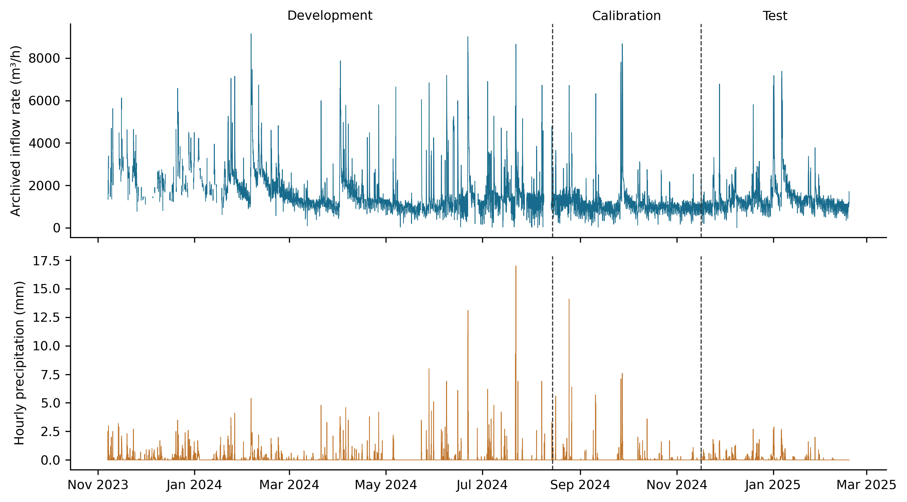
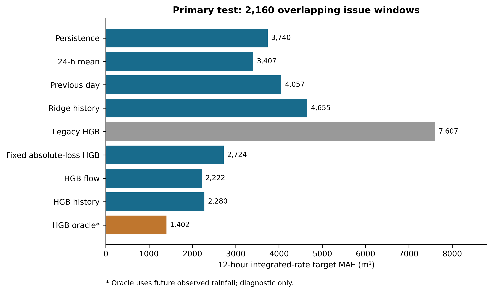
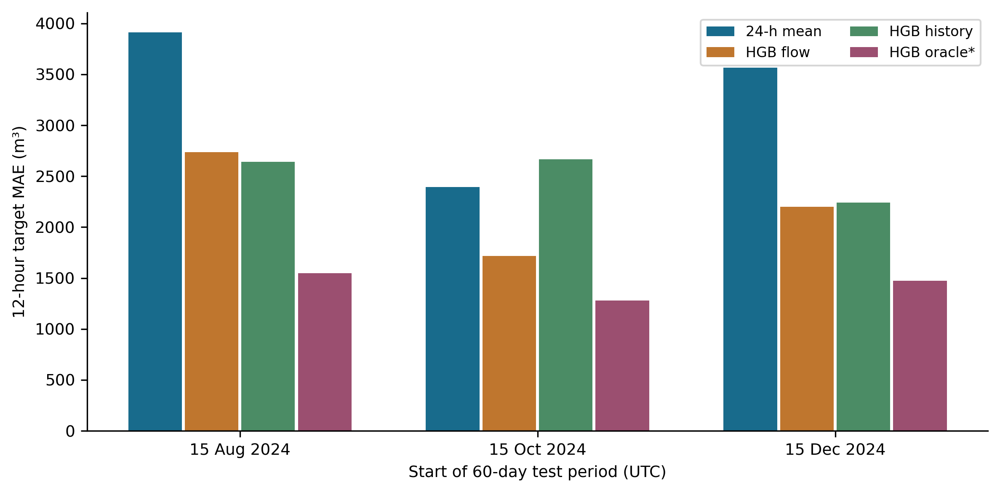
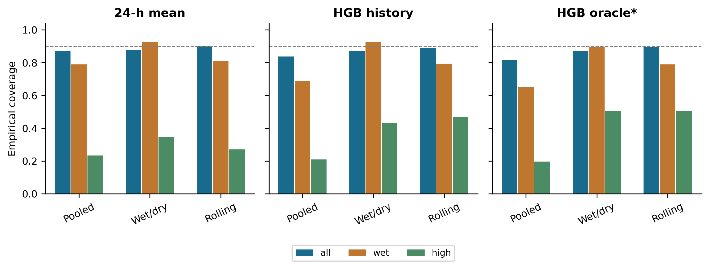
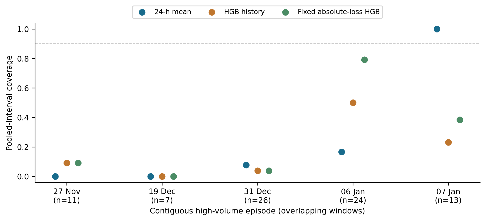

# Configuration sensitivity and conditional reliability in wastewater inflow volume forecasting: a two-site open-data audit

**Viet Nam Tran**

Faculty of Environment, Van Lang University, Ho Chi Minh City, Vietnam

## Highlights

- Loss and annual predictors reversed the ranking of an open inflow benchmark.
- A German-site evaluation added 6,588 test windows and 41 high-volume episodes.
- Historical rainfall gains and rolling calibration behavior differed by site.
- Near-nominal aggregate coverage concealed substantial high-volume errors.
- Versioned data, predictions and executable checks support open reproduction.

## Abstract

Wastewater inflow forecasting requires accurate hydraulic-load estimates and reliable uncertainty statements. We audited open observations from a Danish treatment plant and extended the evaluation to Köln-Weiden, Germany, using a 12-hour integrated-rate approximation of cumulative inflow. Development-only temporal cross-validation selected gradient boosting configurations, including loss and annual predictors. Temporal origins, matched configurations, input delays and residual intervals were evaluated. On the Danish 2,160-window test, historical-input boosting achieved mean absolute error (MAE) of 2,280 m³, compared with 3,407 m³ for a 24-hour mean and 7,607 m³ for the legacy configuration. Historical meteorology did not improve accuracy consistently across Danish periods. On the German 6,588-window test, flow/rain boosting achieved MAE of 1,662 m³, compared with 1,900 m³ for flow/calendar boosting and 3,293 m³ for the mean baseline. Thus, the incremental value of historical rain was site-dependent. Nominal 90% pooled intervals for the historical models covered 83.7% overall versus 21.0% of high-volume windows in Denmark, and 92.6% versus 39.3% in Germany. Rolling calibration improved Danish aggregate coverage but reduced German coverage to 88.5%. High-volume windows comprised five Danish and 41 German threshold-defined episodes. These retrospective findings support configuration audits and separate evaluation of average accuracy and hydraulic-tail reliability. The German models were refitted locally; zero-shot transfer and operational treatment benefits were not established. Versioned data, predictions and executable checks support computational reproduction.

## Keywords

Wastewater inflow; cumulative volume; temporal validation; prediction intervals; model sensitivity; open science.

## 1. Introduction

Machine learning is increasingly used for monitoring and prediction in wastewater treatment [1]. Inflow forecasting addresses the incoming hydraulic boundary condition rather than treatment performance itself. For a treatment plant receiving combined sewage, both routine flow variation and rain-associated changes can affect forecast errors. An openly documented Danish benchmark motivates forecasting at a 12-hour horizon and provides inflow and meteorological observations [2]. Integrated inflow over that horizon is an interpretable planning quantity, although it is not equivalent to required storage capacity or a measured treatment benefit.

Probabilistic inflow prediction and meteorological predictors are established research directions. Sonnenschein and Ziel used rainfall forecasts and sewer-network sensor information for intraday probabilistic WWTP inflow prediction [3]. González Barberá and colleagues studied rain-event inflow forecasting at Spanish Mediterranean coastal plants [4]. Pearson and colleagues combined diffusion-based sewer forecasting with calibrated intervals [5], while Lee and Lee examined adaptive uncertainty estimation for wastewater-plant pH under process drift [6]. These studies preclude claims that rainfall-aware forecasting, wet/dry reliability assessment or adaptive residual calibration are intrinsically new contributions of the present work.

A narrower question remains useful for a public benchmark: how robust is the scientific interpretation of a forecast comparison to its configuration and information boundary? A model that performs poorly with historical measurements may reflect an unsuitable loss or calendar representation. Conversely, improved mean accuracy may coexist with unreliable high-load intervals. Validation must respect temporal structure [7], and wastewater modelling studies have documented difficulties in transfer under changing conditions [8]. Time-series calibration requires assumptions beyond the exchangeable-data argument usually associated with split conformal prediction [9].

We therefore investigate three research questions. RQ1 asks how loss and annual predictors affect relative performance against transparent baselines. RQ2 asks whether historical meteorology and idealized future rainfall add consistent predictive value. RQ3 asks how interval calibration behaves overall, in issue-time wet states and in retrospectively identified high-volume windows. Directional expectations were that historical meteorology would reduce error, oracle rainfall would further reduce error, and high-volume coverage would be poorer than aggregate coverage. These are exploratory expectations, not preregistered confirmatory hypotheses.

The contribution is a traceable audit of an integrated inflow target: matched configuration comparisons, development-selected information sets, multiple temporal test periods, maturity-aware residual updates and episode-level diagnostics, extended to a second independently sourced site. We do not propose a new learning algorithm. The targeted literature review supports this restricted contribution, but does not establish that the exact design is unprecedented. The Danish revision was formulated after its original results had been examined. An external-site extension was documented before computing German forecast errors. Both use archived observations and are retrospective; neither was independently preregistered.

## 2. Materials and Methods

### 2.1. Data provenance and interpretation

We used DHI's version-1 Zenodo archive, DOI 10.5281/zenodo.15301164 [2]. It describes an anonymized Danish WWTP receiving combined sewage and nearby meteorological observations from the Danish Meteorological Institute. Provider MD5 checksums were verified for the observations and processed archives; local SHA-256 hashes accompany the release. Analysis starts from the observation files, not the provider's interpolated processed table. Zenodo metadata records CC BY-NC 4.0. Third-party data retain those terms and attribution; the analysis-code license does not override them.

The flow file contains 9,868 hourly records. Observed meteorological variables include precipitation, pressure, radiation, humidity and temperature. No effluent-quality, energy, storage-level, operating-capacity or control-action series is available. The provider's example predicts a flow trajectory and deliberately includes future observed rain under a perfect-forecast assumption. It is relevant prior use of the same data, but its scores are not directly comparable with our integrated target and eligibility rules. We did not perform an exact reproduction of that example.

### 2.2. Alignment, screening and eligible observations

Flow timestamps were interpreted in Europe/Copenhagen and converted to UTC; one ambiguous daylight-saving timestamp was removed. Meteorological timestamps were treated as UTC according to the provider's preprocessing documentation. There were no duplicate retained UTC flow timestamps. The aligned hourly grid has 11,257 positions from 7 November 2023 to 18 February 2025.

Screening marked flow below 2 m³/h and the endpoint of a trailing six-hour window whose range was below 5 m³/h. These heuristic flags identified six low observations and 18 flat-window endpoints. They are not validated sensor-fault labels. Extremes were retained, and humidity outside 0-100% was marked missing. Grass and soil temperatures were excluded because of extensive gaps. Screening increased missing flow from 1,390 to 1,414 hourly positions. An unscreened refit was included as a sensitivity analysis.

Target values were never interpolated. Eligibility required a complete target window, complete inputs for all three baselines, a preceding-six-hour rain sum and a complete oracle rainfall window. All information sets were compared on the same eligible issues. Future-rain completeness did not remove otherwise eligible primary-test issues in this archive; in another dataset it could cause selection bias. Remaining predictor gaps were imputed using development-fold medians with missingness indicators. Complete-window selection restricts conclusions to monitored periods and may exclude difficult operating states.

### 2.3. Target and information boundary

For issue time t and horizon h, we define

**V(t,h) = Σ[k=1,…,h] Q(t+k) Δt, with Δt = 1 hour.**

Q is the archived flow-rate value in m³/h. V is an integrated-rate approximation expressed in m³. The provider material inspected does not independently establish whether each hourly value is an interval mean or an instantaneous sample; exact cumulative-volume interpretation therefore requires confirmation. The primary horizon was 12 hours, with six and 24 hours as sensitivities. We assume measurements stamped t are available at issue time t, then examine one- and two-hour delays. These assumptions are not statements about the actual plant telemetry.

Historical flow features comprised lags 0, 1, 2, 3, 6, 12, 24, 48 and 168 hours, and trailing means and standard deviations over 6, 12 and 24 hours. Calendar variables encoded hour, weekday and day of year using sine and cosine. Historical weather added rainfall sums over 1, 6, 12, 24 and 72 hours and current/trailing-six-hour means of pressure, radiation, humidity and air temperature. The oracle additionally used the total and maximum observed rainfall from t+1 to t+h. It is deliberately non-operational and is not a theoretical upper bound on forecasting skill.

### 2.4. Temporal design and model selection

The primary split retained the original elapsed-time 60/20/20 boundaries: 14 August 2024 at 10:00 UTC and 16 November 2024 at 05:00 UTC. A training or calibration issue was removed if its target reached the next partition. Three further 60-day tests began on 15 August, 15 October and 15 December 2024, each preceded by 45 calendar days of calibration and an expanding development period. The three test periods do not overlap each other, but they overlap data already examined in the original study. They are temporal robustness analyses, not external or previously untouched validation. Targets reaching each test-period end were excluded.

Baselines were persistence, hQ(t); the preceding-24-hour mean multiplied by h; and the corresponding previous-day profile sum. The last two coincide at h=24. Ridge regression used historical inputs, with alpha in 1, 100 and 10,000. Histogram gradient boosting (HGB) was evaluated with flow/calendar, historical-weather and oracle information sets. Each HGB search covered 16 combinations: squared versus absolute-error loss, annual predictors included versus omitted, 7 versus 15 maximum leaves, and L2 penalty 1 versus 10. Other settings were 150 iterations, learning rate 0.05 and minimum leaf size 30; internal early stopping was disabled. The seed was 20261110.

Three expanding temporal folds within development selected the lowest mean validation MAE. Each fold had a gap of h eligible issues, which is at least h elapsed hours. Imputation and ridge scaling were fitted within folds. Point predictions were truncated at zero. Outer models remained fixed throughout calibration and testing; rolling calibration below updates only residual intervals. No test score selected hyperparameters. Nevertheless, the expanded search itself followed inspection of the earlier results, so the overall study remains retrospective.

A legacy historical HGB retained squared loss, annual predictors, seven leaves and L2=10. Matched fixed HGB comparisons used absolute loss, annual predictors, seven leaves and L2=10 for all three information sets. A further 2×2 loss/annual comparison fixed seven leaves and L2=1, the primary historical model's development-selected structural settings. This additional diagnostic was added after the revised selection was observed, and is disclosed as such rather than presented as a priori evidence.

### 2.5. Residual intervals and delayed information

Absolute calibration residuals defined a nominal 90% radius. With n finite residuals, k=ceil[(n+1)×0.9] and the radius is exactly the kth ordered residual. If k exceeds n, the radius is infinite; empty or non-finite input is rejected. This fixes the extra-rank error in the preceding version. Lower bounds are truncated at zero. The finite-sample rank convention does not confer exchangeability or conditional-coverage guarantees on this series.

We compared a fixed pooled radius, fixed wet/dry radii and a rolling radius. Wet denotes positive rain in the six preceding hours and is observable at issue time under the latency assumption. A wet/dry stratum requires at least 30 calibration residuals, otherwise it falls back to the pooled radius. Rolling calibration uses residuals whose labels have matured by t, meaning issue+h≤t, and whose maturation times fall in the preceding 30 calendar days. It requires 30 residuals, otherwise using the original calibration pool. This is a transparent rolling-residual benchmark, not an implementation of SPCI or adaptive conformal inference [6,9].

Delay sensitivities shifted every measured historical predictor by one or two hours while retaining issue-time calendar values. The primary selected parameters were held fixed during refitting; all comparisons used common valid test issues. The no-screening sensitivity also refitted those parameters. The resulting tests do not resolve unknown sensor aggregation conventions, forecast-vintage availability or missing-not-at-random mechanisms.

### 2.6. Statistical analysis and uncertainty

MAE was the primary point metric. RMSE, R², mean bias and mean positive underprediction were secondary. Interval measures were empirical coverage, width, upper exceedance and the 90% interval score: width plus 20 times each lower or upper miss. High volume was defined by the development-target 90th percentile separately for each temporal design. This outcome-defined subgroup is retrospective; it is not equivalent to conditioning on predictors available at issue time.

Paired differences in absolute error were resampled with 2,000 fixed-length circular-block replicates, using 24, 48 and 168 retained hourly positions. Blocks wrap within each contiguous eligible run, never crossing a missing-time gap. Start positions are sampled uniformly from all eligible issues; every issue therefore has equal marginal inclusion, including in short runs. The final block is truncated to preserve sample size. Circular wrapping creates artificial end-to-start adjacency, and stationarity within runs is uncertain. We label the 2.5th-97.5th percentile ranges as approximate bootstrap sensitivity intervals, not guaranteed 95% confidence intervals. No confirmatory p-values or multiple-hypothesis rejection claims are made.

Every contiguous high-volume episode was reported, together with leave-one-episode-out coverage and all 12 issue-time phases of nonoverlapping 12-hour targets. These episodes need not be independent storms. A separate, explicitly synthetic AR(1) experiment examined bootstrap behavior under stationary dependence; its data are not plant observations and its results do not validate coverage under real nonstationarity. Full grids, fold scores, calibration predictions, test predictions and interval bounds for the main models are retained.

### 2.7. External-site methodological replication

To address reliance on one plant, we added the Köln-Weiden archive from Sonnenschein and Ziel, DOI 10.5281/zenodo.6992694, version 1.0 [10], associated with the prior intraday forecasting study [3]. This is a previously published dataset, not new field sampling. Its CC BY 4.0 license and provider MD5 checksum were verified. The CSV documents flow in L/s and rainfall rate in mm/min at 15-minute intervals. It contains 105,120 timestamps from 2017 through 2019, with three missing values in each of these two variables and no duplicated or irregular timestamps.

We retained the archive's uniform, timezone-unspecified clock and do not label it UTC. Each hourly value ending at t required four finite nonnegative samples in (t-1 hour,t]. Mean flow was multiplied by 3.6 to obtain m³/h; rainfall rates were summed and multiplied by 15 minutes to obtain hourly mm. These are integrated-rate approximations rather than independently verified volumetric meter readings. Right-closed aggregation avoids using samples after the issue time. No interpolation or transport of the Danish low/flat screening thresholds was applied. Available sewer-level variables were not added, so the historical information comparison remained flow/calendar versus flow/calendar/rain; other Danish meteorological variables were unavailable.

Development covered 2017-2018, calibration January-March 2019, and testing April-December 2019, with the same horizon purges. We fixed the 12-hour target, baselines, 16-candidate HGB grid, development-fold selection and three interval methods before calculating external errors. Models were fitted on German development observations; this evaluates the approach at an independent site and is not zero-shot transfer of a Danish trained model. Matched diagnostics fixed seven leaves and L2=1 while varying loss/annual features, and compared fixed absolute-loss/no-annual information sets. MAE divided by the site's mean test target was reported to contextualize scale; m³ errors were not pooled across sites. The separately archived radar-forecast file was inspected but not used: its numbered columns were not verified to constitute a complete operational 12-hour forecast with known availability times.

## 3. Results

### 3.1. Retention and observed shifts

The primary 12-hour analysis retained 4,398 development, 2,089 calibration and 2,160 test windows. Eligible development issues began on 20 January 2024, substantially later than the archive start because of missing complete windows. Test issues ran from 16 November 2024 at 05:00 UTC to 17 February 2025 at 11:00 UTC. Mean targets were 19,942, 13,728 and 16,447 m³ in the three partitions. These are observed distribution differences, not identified causal effects of season or plant operation. Figure 1 shows the underlying measurements and split boundaries.

**Figure 1.** Archived inflow rate and hourly precipitation on the aligned UTC grid. Dashed lines mark the primary development/calibration/test boundaries. Missing periods remain missing; a plotted measurement does not imply that its complete target window is eligible.

The primary high-volume threshold was 32,304.98 m³. Eighty-one test windows exceeded it, distributed across five contiguous episodes of 11, 7, 26, 24 and 13 windows. The test contained 707 wet and 1,453 dry issues. Additional temporal tests retained 1,318, 1,355 and 1,385 issues; their development-derived thresholds differed and are reported in the supplement.

### 3.2. Configuration sensitivity changes the primary interpretation

The selected primary historical model used absolute-error loss, omitted annual predictors, and used seven leaves with L2=1. Its MAE was 2,280.1 m³, 33.1% below the 24-hour mean baseline. Flow/calendar HGB had slightly lower MAE, 2,221.7 m³. The legacy historical HGB had MAE 7,607.1 m³ and substantial positive bias (Table 1; Figure 2). Thus, the preceding version's baseline-versus-HGB ranking cannot be generalized beyond its restricted configuration search.

**Table 1. Primary 12-hour test performance (n=2,160).** Legacy and fixed rows are diagnostic configurations, not models selected from test outcomes. Oracle rainfall is unavailable in real time. Bias is prediction minus observation. Errors refer to the integrated-rate approximation.

| Configuration | MAE (m³) | RMSE (m³) | R² | Bias (m³) |
| --- | --- | --- | --- | --- |
| Persistence | 3,740.2 | 6,185.4 | 0.219 | 168.4 |
| Previous 24-hour mean | 3,406.6 | 6,128.2 | 0.233 | 229.6 |
| Previous-day profile | 4,056.8 | 7,787.9 | -0.239 | 217.7 |
| Ridge, historical | 4,655.3 | 5,743.8 | 0.326 | 3,250.7 |
| Legacy HGB, squared loss | 7,607.1 | 8,633.0 | -0.522 | 6,811.4 |
| Fixed HGB, absolute loss | 2,723.8 | 4,554.2 | 0.576 | 575.0 |
| HGB, flow/calendar | 2,221.7 | 4,600.5 | 0.568 | -645.3 |
| HGB, historical | 2,280.1 | 4,470.6 | 0.592 | -330.5 |
| HGB, oracle rainfall | 1,402.3 | 2,280.8 | 0.894 | 122.9 |

**Figure 2.** Primary-test MAE for baselines, selected models and retained configuration diagnostics. All rows use the same target windows. The oracle uses future observed rainfall.

In the matched 2×2 diagnostic with seven leaves and L2=1, squared loss with annual predictors yielded MAE 7,965.9 m³; omitting annual predictors reduced it to 3,403.6 m³. Absolute loss yielded 2,760.6 m³ with annual predictors and 2,280.1 m³ without them. These comparisons separate the two configuration changes at fixed tree-size and regularization settings, but do not identify their physical causes. Removing annual features from the already selected primary model changed nothing, as expected.

Historical HGB minus the mean baseline had a paired MAE difference of -1,126.5 m³, with a 48-hour bootstrap sensitivity range of -1,700.9 to -671.5 m³. Ranges at 24 and 168 hours also remained below zero. By contrast, mean baseline minus persistence was -333.6 m³ with a range of -782.3 to 167.3 m³. The mean baseline's smaller point error should therefore not be described as a definitive improvement over persistence.

### 3.3. Information sets and temporal robustness

Adding historical weather to flow/calendar HGB changed primary MAE by +58.5 m³, with a 48-hour sensitivity range of -27.0 to 139.8 m³. The matched fixed-configuration comparison gave +49.7 m³, with a range of -70.3 to 168.9 m³. Neither comparison supports a consistent historical-weather advantage on this period.

The selected oracle achieved MAE 1,402.3 m³, compared with 2,280.1 m³ for selected historical HGB. Its paired difference was -877.9 m³, with a sensitivity range of -1,326.8 to -514.6 m³. Holding the absolute-loss configuration fixed across information sets gave an oracle advantage of 681.6 m³. These are diagnostic benefits of perfect future observations, not expected benefits of an operational weather service.

Table 2 and Figure 3 show the additional origins. Flow/calendar HGB improved on the mean baseline in all three periods. Historical-weather HGB improved in the August and December tests, but its October MAE exceeded the baseline and flow-only HGB. For that origin, development selected annual predictors for historical HGB but omitted them for flow HGB. Accordingly, the selected-model difference combines information and configuration; the matched comparisons in the supplement must be consulted before attributing it to weather information alone.

**Table 2. Twelve-hour MAE (m³) in additional 60-day temporal tests.** Each origin has its own expanding development period and preceding 45-day calibration period. These retrospective tests are not independent-site validation.

| Test start | n | 24-h mean | HGB flow | HGB history | HGB oracle |
| --- | --- | --- | --- | --- | --- |
| 2024-08-15 | 1318 | 3,910.2 | 2,734.6 | 2,643.1 | 1,546.6 |
| 2024-10-15 | 1355 | 2,392.0 | 1,716.4 | 2,666.2 | 1,278.8 |
| 2024-12-15 | 1385 | 3,563.6 | 2,198.6 | 2,238.9 | 1,475.3 |

**Figure 3.** Model errors at the three additional temporal origins. The test periods do not overlap each other. Their observations had already been available during the broader retrospective study. Oracle results remain diagnostic.

At six hours, historical HGB had MAE 1,026.6 m³ versus 1,567.7 m³ for persistence. At 24 hours, historical HGB had MAE 7,683.7 m³ versus 6,588.9 m³ for the mean baseline; the oracle achieved 3,178.9 m³. The longer-horizon result prevents a universal claim that historical HGB is preferable. Targets and eligible samples also differ across horizons, so raw errors are not directly comparable between them.

### 3.4. Interval reliability and high-volume episodes

With the corrected order statistic, the mean baseline's pooled interval covered 87.1% overall and 23.5% of high-volume windows. Historical HGB covered 83.7% overall and 21.0% of high-volume windows (Table 3; Figure 4). Better average point accuracy therefore did not imply satisfactory tail reliability. The oracle's pooled coverage was only 81.7% overall despite its low MAE, reflecting the mismatch between its calibration errors and later errors.

**Table 3. Empirical coverage of nominal 90% intervals and mean width on the primary test.** Overall n=2,160; wet n=707; high-volume n=81 in five episodes. Width is averaged over all test issues. Neither the nominal level nor these percentages imply a conditional-coverage guarantee.

| Model | Calibration | All (%) | Wet (%) | High (%) | Width (m³) |
| --- | --- | --- | --- | --- | --- |
| 24-h mean | Pooled | 87.1 | 78.9 | 23.5 | 13,893 |
| 24-h mean | Wet/dry | 88.0 | 92.6 | 34.6 | 16,001 |
| 24-h mean | Rolling 30 d | 90.1 | 81.2 | 27.2 | 18,197 |
| HGB history | Pooled | 83.7 | 69.0 | 21.0 | 6,747 |
| HGB history | Wet/dry | 87.1 | 92.5 | 43.2 | 8,610 |
| HGB history | Rolling 30 d | 88.8 | 79.5 | 46.9 | 9,934 |
| HGB oracle | Pooled | 81.7 | 65.2 | 19.8 | 4,495 |
| HGB oracle | Wet/dry | 87.1 | 89.5 | 50.6 | 5,624 |
| HGB oracle | Rolling 30 d | 89.4 | 78.9 | 50.6 | 6,565 |

**Figure 4.** Aggregate, issue-time wet-state and retrospective high-volume coverage for three residual-calibration methods. The dashed line marks the nominal 90% level. Rolling calibration uses only matured residuals.

For historical HGB, wet/dry calibration raised wet-state coverage from 69.0% to 92.5% while increasing overall mean width from 6,747 to 8,610 m³. Rolling calibration achieved 88.8% overall and 46.9% high-volume coverage, with mean width 9,934 m³. For the mean baseline, rolling coverage reached 90.1% overall but only 27.2% in high-volume windows. Its mean interval score increased from 32,459 to 35,222 m³ despite improved overall coverage, illustrating why coverage must be read together with sharpness and miss penalties.

Episode-specific coverage varied markedly (Figure 5). For the mean baseline, omitting one high-volume episode changed the remaining pooled coverage from 8.8% to 30.9%; for historical HGB the range was 8.8-29.1%. The 12 nonoverlapping target phases contained only 6-8 high-volume windows each. Their high-volume coverage ranged from 14.3% to 33.3% for the mean baseline and 0-50.0% for historical HGB. These ranges demonstrate sparse-event sensitivity; they are not independent confidence intervals.

**Figure 5.** Pooled-interval coverage within every primary-test high-volume episode. Dates mark the first issue in each episode; n is the number of overlapping high-target windows. Episodes are threshold-defined and cannot be assumed to be independent meteorological storms.

### 3.5. Input delays, screening and verification

On common test issues, a one-hour delay increased historical HGB MAE from 2,277.7 to 2,417.5 m³ (n=2,158); a two-hour delay increased it from 2,277.1 to 2,598.3 m³ (n=2,156). The mean baseline increased from 3,396.4 to 3,480.3 m³ and from 3,389.4 to 3,545.6 m³, respectively. This sensitivity supports explicit timing assumptions but does not estimate actual plant latency.

Without low/flat screening, development and calibration counts increased to 4,656 and 2,126. The same 2,160 primary-test targets remained, and the refitted historical HGB had MAE 2,252.1 m³, close to the screened result. This one sensitivity does not establish that the screening rules correctly identify faulty measurements.

Automated checks reconstructed 19,618 calibration/test target values from hourly observations; recomputed 1,584 main point-metric values and 3,960 interval-metric values; compared all 198 main model-method interval arrays; and checked temporal boundaries, quantile edge cases, historical-feature causality and residual maturation. Additional sensitivity metrics were recomputed, and deliberately empty, missing, altered and schema-mismatched reference comparisons failed as intended. A second complete run in a newly created Python environment reproduced all 34 registered CSV outputs within the declared tolerances (relative 10⁻¹⁰, absolute 10⁻⁸); the maximum absolute numerical difference was 0. These checks verify computation, not sensor validity or scientific generalizability.

### 3.6. Evidence from the German site

The external evaluation retained 17,484 development, 2,124 calibration and 6,588 test issues. The mean German test target was 7,846.3 m³, compared with 16,447.4 m³ at the Danish primary test. The German development-derived high-volume threshold was 14,099.0 m³, exceeded by 700 test windows in 41 contiguous episodes. This substantially increases episode representation relative to the Danish five episodes, but does not establish meteorological independence or population-wide generality.

Flow/rain HGB achieved MAE 1,661.9 m³ versus 1,899.8 m³ for flow/calendar HGB and 3,293.1 m³ for the mean baseline (Table 4). The rain-versus-flow paired difference was -238.0 m³, with a 48-hour bootstrap sensitivity range of -338.3 to -154.2 m³; the matched fixed-configuration difference was -239.3 m³. Unlike the Danish primary result, historical rain improved accuracy here. The selected rain model's MAE/mean-target ratio was 21.2%; the corresponding Danish historical-model ratio was 13.9%. This difference is descriptive, with different sites, periods and available covariates.

**Table 4. External-site 12-hour test performance at Köln-Weiden (n=6,588).** Models were trained locally using 2017-2018 observations. MAE/mean is MAE divided by the mean test target, not MAPE. Oracle rainfall is non-operational.

| Configuration | MAE (m³) | RMSE (m³) | R² | MAE/mean (%) |
| --- | --- | --- | --- | --- |
| Persistence | 3,378.2 | 5,297.0 | 0.043 | 43.1 |
| 24-hour mean | 3,293.1 | 5,748.4 | -0.127 | 42.0 |
| Previous day | 3,581.8 | 7,019.0 | -0.680 | 45.6 |
| HGB flow/calendar | 1,899.8 | 4,320.5 | 0.363 | 24.2 |
| HGB flow/rain | 1,661.9 | 3,774.1 | 0.514 | 21.2 |
| HGB oracle | 832.6 | 1,758.3 | 0.895 | 10.6 |

The loss/calendar effect also differed by site. With seven leaves and L2=1, German squared-loss MAE was 1,866.3 m³ with annual predictors and 1,929.1 m³ without them; absolute-loss MAE was 1,666.7 and 1,660.5 m³, respectively. The large Danish deterioration from including annual predictors under squared loss therefore did not recur in Germany. This supports configuration sensitivity as a reason to audit, rather than a universal rule to remove annual predictors.

For German flow/rain HGB, pooled intervals covered 92.6% overall but 39.3% of high-volume windows. Wet/dry calibration gave 90.6% and 54.1%, whereas rolling calibration gave 88.5% and 32.9%. Mean widths were 12,852, 8,504 and 9,145 m³, respectively. Thus rolling adaptation did not uniformly improve reliability. The oracle had pooled coverage of 94.3% overall and 68.3% in the high-volume subgroup, despite its small MAE of 832.6 m³. The external evidence supports concern about aggregate versus tail reliability while showing that the best calibration response is site-dependent.

A separate clean-environment rerun reproduced all 12 external CSV tables with maximum absolute numerical difference 0.0. Direct checks reconstructed each external calibration/test target from 48 quarter-hour flow-rate samples using the documented unit conversion.

## 4. Discussion

### 4.1. A configuration-dependent failure is not an information limit

The central correction is substantive: the strong apparent superiority of a simple historical baseline in the earlier restricted benchmark disappeared after development-only selection of loss and annual predictors. Absolute-error fitting targets a different predictive functional from squared-error fitting, and a short, shifting record may provide limited support for annual representations. The matched 2×2 results show sensitivity to both choices without proving a specific mechanism. A negative model result must therefore be bounded by the configuration actually evaluated.

The revision also illustrates a limitation of retrospective improvement. Although each search used only development folds, the choice to expand that search arose after observing poor earlier test performance. The final test is consequently not a fresh confirmatory sample. Retaining the legacy configuration, all candidates and the revision history makes this dependence visible. Further Danish temporal tests reduce reliance on one split, while the German extension addresses site specificity through local refitting. Neither design replaces a prospective operating-period evaluation.

### 4.2. Meteorological information and practical forecasts

Rainfall-aware wastewater prediction has substantial prior art [3,4]. Our results do not contradict it: the present weather station, historical summaries, target and data duration differ from those studies. Flow lags may already encode part of the recent hydraulic response, but that explanation is an inference rather than a measured network mechanism. The October-origin result also warns that separately selected models can confound a feature-set comparison with different configuration choices.

The oracle advantage at both sites establishes room for improved information under the evaluated modelling conditions. The observed historical-rain advantage in Germany also shows that the Danish null comparison is not a general statement about rainfall information. It does not measure the value of actual rainfall forecasts, which have error, latency, changing vintages and potentially different spatial support. The provider's own perfect-rainfall example [2] makes this distinction particularly important. A useful next experiment would replay archived numerical-weather forecasts available at each issue time, using the same hydraulic target and complete information boundary.

### 4.3. Marginal reliability cannot stand in for tail reliability

Wet/dry and rolling calibration improved some empirical reliability measures, consistent with the broader motivation for regime-aware and adaptive sewer or wastewater uncertainty methods [5,6]. Nevertheless, our simple residual procedures neither implement those methods exactly nor inherit their theoretical properties. SPCI, for example, models the conditional behavior of future residual quantiles [9]; a fixed empirical radius or a 30-day residual window is a different procedure.

High-volume conditioning uses the future outcome, so its coverage cannot be interpreted as the conditional guarantee on available predictors commonly sought by forecasting methods. It remains an engineering-relevant stress diagnostic: severe upper misses could matter to a plant even when aggregate coverage appears acceptable. Here the rolling mean-baseline interval reached approximately 90% overall while missing most high-volume outcomes. Sparse, overlapping Danish episodes prevent reliable estimation of rare-event performance and prohibit treating 81 windows as 81 independent hydraulic events. The German 700 high-volume windows in 41 episodes broaden the evidence but still do not represent 700 independent events.

The uncertainty estimates themselves deserve restraint. Fixed-length circular blocks correct the earlier unequal marginal weighting, but introduce wrapping and depend on an approximate stationarity argument. In the explicitly synthetic stationary diagnostic (n=1,920, block=48, 200 Monte Carlo series and 400 resamples per series), empirical coverage of the mean's nominal 95% percentile range was 94.0%, 95.0% and 89.5% for AR(1) coefficients 0, 0.5 and 0.9. Monte Carlo standard errors were approximately 1.7, 1.5 and 2.2 percentage points. Even this controlled example cautions against interpreting the real-data sensitivity ranges as guaranteed inferential coverage.

## 5. Practical implications

The results support a staged evaluation for hydraulic forecasting: retain transparent baselines; test plausible loss and calendar choices; disclose the measurement and weather information available at issue time; and examine reliability during relevant operating conditions. Report interval width and miss penalties alongside coverage. Across both evaluated sites, flow-based boosting is a credible 12-hour predictive benchmark, while high-volume residual intervals require further work. Historical rainfall and rolling calibration should be re-evaluated locally because their incremental performance differed between sites.

No numerical storage recommendation follows from these forecast errors. Converting an inflow forecast into a control decision would require initial stored volume, outflow capacity, treatment constraints, uncertainty in those variables and an explicit decision loss. The present evidence likewise does not establish pollutant-removal gains, avoided overflows or energy savings. A prospective test should use provider-confirmed timestamps, actual forecast vintages, multiple sites and event-level operational endpoints.

## 6. Limitations

The evaluation covers two plants with different record lengths and measurement documentation, not a representative sample of treatment systems. The Danish plant is anonymized and has approximately 15 months of incomplete observations; its effective development history is shorter. The German archive spans three years but does not establish the time zone or real sensor-availability times. Integrated volumes are approximated from rate samples; Danish aggregation semantics remain unconfirmed. Complete-window selection and heuristic Danish screening can affect representativeness. The unscreened refit does not eliminate missingness bias.

The Danish revision reuses previously inspected outcomes. The external design was documented before its model errors were calculated, but is still a retrospective, non-preregistered evaluation selected after the Danish audit. Local German refitting is not zero-shot transfer, and differences between sites cannot isolate the effect of climate, catchment, record length or sensing. The learning family and search remain limited. No mechanistic comparator, prospective control trial or fully verified operational weather-forecast replay was performed. Network levels at the German site do not by themselves provide storage geometry, action constraints or treatment endpoints. Threshold-defined episodes may remain dependent. Bootstrap ranges are assumption-sensitive, and no globally unique method or guaranteed publication readiness is claimed.

## 7. Conclusions

Loss and annual-predictor choices materially changed the interpretation of the Danish wastewater inflow benchmark. Development-selected historical HGB reduced its primary 12-hour MAE to 2,280 m³ compared with 3,407 m³ for a 24-hour mean and 7,607 m³ for the legacy configuration. Three further Danish origins and a German-site evaluation supported the usefulness of flow-based 12-hour prediction, but historical rainfall gains and calendar sensitivity were site-dependent. In Germany, flow/rain HGB achieved MAE 1,662 m³ versus 3,293 m³ for the mean baseline. Near-nominal aggregate interval coverage coexisted with high-volume undercoverage at both sites; rolling calibration improved some Danish measures but deteriorated in Germany. The complete computational evidence is openly reproducible. Prospective forecast availability, additional sites and operational decision endpoints remain necessary before claiming treatment or control benefits.

## Data Availability Statement

Source observations and processed data are archived by DHI as *Inflow to a Waste Water Treatment Plant: observations and processed data*, version 1, DOI [10.5281/zenodo.15301164](https://doi.org/10.5281/zenodo.15301164), with CC BY-NC 4.0 recorded in the archive metadata. DHI and the Danish Meteorological Institute are credited for plant and weather measurements. The supplementary package preserves source archives, hashes, transformations and derived predictions. The external observations are available from Sonnenschein and Ziel [10], DOI [10.5281/zenodo.6992694](https://doi.org/10.5281/zenodo.6992694), under CC BY 4.0. Both sources and transformations are identified separately. No new measurements were collected. Users must retain each source license and attribution; the Danish non-commercial terms are not imposed on the independently licensed German source.

## Code Availability Statement

Analysis code and the versioned supplement are available at [the public GitHub repository](https://github.com/phamnam123lite-svg/wastewater-inflow-volume-open-science), release [v0.2.0](https://github.com/phamnam123lite-svg/wastewater-inflow-volume-open-science/releases/tag/v0.2.0). The release includes the revision protocol, locked dependencies, download and analysis scripts, full cross-validation results, saved forecasts and intervals, figures, fail-closed verification, numerical references and a clean-environment reproduction report. Newly authored code is MIT licensed; data retain their separate terms. The earlier release remains identifiable as historical provenance. GitHub versioning is not a persistent DOI archive, and the source-data DOI is not a DOI for this manuscript or code.

## Funding

This research received no external funding, as declared by the author.

## Declaration of competing interests

The author declares no competing interests.

## Acknowledgements and use of AI tools

The author acknowledges DHI and the Danish Meteorological Institute for making the source observations available. OpenAI ChatGPT/Codex assisted with literature discovery, coding, computation, verification and manuscript drafting. AI assistance is not independent human peer review. The named human author is responsible for reviewing the evidence and approving any submitted version; no statement of completed author approval is implied by this draft.

## References

1. Yang, W., and Li, H. (2025). Machine Learning in Wastewater Treatment: A Comprehensive Bibliometric Review. *ACS ES&T Water*, 5, 511-524. [doi:10.1021/acsestwater.4c01047](https://doi.org/10.1021/acsestwater.4c01047).

2. DHI (2025). *Inflow to a Waste Water Treatment Plant: observations and processed data*, version 1. Zenodo. [doi:10.5281/zenodo.15301164](https://doi.org/10.5281/zenodo.15301164). Provider example: [WaterBench-TimeSeries-WWTPINflow](https://github.com/DHI/WaterBench-TimeSeries-WWTPINflow), inspected commit 68cc22b5de3bbbc09c0bf63c6d5a9ef376d5fd6c; data pinned to Zenodo v1.

3. Sonnenschein, B., and Ziel, F. (2023). Probabilistic Intraday Wastewater Treatment Plant Inflow Forecast Utilizing Rain Forecast Data and Sewer Network Sensor Data. *Water Resources Research*, 59, e2022WR033826. [doi:10.1029/2022WR033826](https://doi.org/10.1029/2022WR033826).

4. González Barberá, A., Iserte, S., Castillo, M., Luis-Gómez, J., Martínez-Cuenca, R., Monrós-Andreu, G., and Chiva, S. (2025). Machine Learning-Based Forecasting of Wastewater Inflow During Rain Events at a Spanish Mediterranean Coastal WWTPs. *Water*, 17, 3225. [doi:10.3390/w17223225](https://doi.org/10.3390/w17223225).

5. Pearson, N. A., Cairoli, F., Bortolussi, L., Russo, D., and Zanello, F. (2025). Diffusion-based Time Series Forecasting for Sewerage Systems. *arXiv:2506.08577*, version 1; accepted for presentation at the 13th Urban Drainage Modelling Conference. [doi:10.48550/arXiv.2506.08577](https://doi.org/10.48550/arXiv.2506.08577).

6. Lee, Jongyeop, and Lee, Jong Min (2026). Adaptive Conformal Prediction for Full-Scale Plant pH Forecasting under Process Drift. *Proceedings of the Fifteenth Symposium on Conformal and Probabilistic Prediction with Applications*, PMLR 329, 1043-1045. [Publisher record](https://proceedings.mlr.press/v329/lee26a.html).

7. Roberts, D. R., Bahn, V., Ciuti, S., Boyce, M. S., Elith, J., Guillera-Arroita, G., Hauenstein, S., Lahoz-Monfort, J. J., Schröder, B., Thuiller, W., Warton, D. I., Wintle, B. A., Hartig, F., and Dormann, C. F. (2017). Cross-validation strategies for data with temporal, spatial, hierarchical, or phylogenetic structure. *Ecography*, 40, 913-929. [doi:10.1111/ecog.02881](https://doi.org/10.1111/ecog.02881).

8. Bøhn, E., Eidnes, S., and Jonassen, K. R. (2024). Machine learning in wastewater treatment: insights from modelling a pilot denitrification reactor. *arXiv:2412.14030*. [Author/version record](https://arxiv.org/abs/2412.14030). Version 1 published in December 2024; version 2 in June 2025.

9. Xu, C., and Xie, Y. (2023). Sequential Predictive Conformal Inference for Time Series. *Proceedings of the 40th International Conference on Machine Learning*, PMLR 202, 38707-38727. [Publisher record](https://proceedings.mlr.press/v202/xu23r.html).

10. Sonnenschein, B., and Ziel, F. (2022). *Wastewater Treatment Plant Inflow Rate, Network Water Levels and Rain Rate for Koeln Weiden, Germany*, version 1.0. Zenodo. [doi:10.5281/zenodo.6992694](https://doi.org/10.5281/zenodo.6992694).
